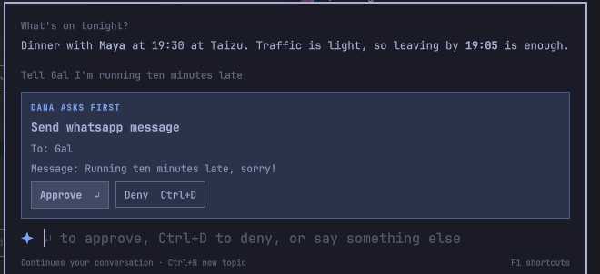
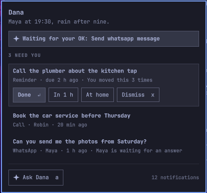

# Dana for Omarchy



A plugin for [Omarchy](https://omarchy.org)'s shell (Omarchy 4, the Quickshell desktop) that puts Dana one key away
without a window to manage. It lives inside the shell like the bar and the menus: nothing is tiled, focus goes back to
where it was, and it follows the theme, the corners and the language the way Omarchy's own panels do.

| | |
|---|---|
| **Super+D** | Ask. A card opens in the upper middle of the screen; type and press Enter, and the answer streams in under the question. **Esc** closes it and Dana keeps going: the answer, or her question back, arrives as a notification, and clicking it brings the card back. |
| **Super+Alt+D** | Ask about the screen. Pick a region (as with Omarchy's OCR capture); the card opens with that screenshot attached. A screenshot already on the clipboard pastes in with Ctrl+V. |
| **The bar** | ✦ shows how many cards in Dana's **Now** queue need a decision (a dot on a vertical bar). It pulses while she works on something you asked here and takes the bar's alert colour while she waits for your OK. While a **live activity** runs (a watched train, a coding session, a timer), the soonest one takes the glyph's place: its icon and its countdown, ticking (`󰔬 7:42`, then the Now count: `󰔬 7:42 · 2`). Click: the Now panel. Right click: ask. Middle click: refresh. |



## How it behaves

- **One conversation everywhere.** The card writes to Dana's shared thread (`session_id: "main"`, `device: "desktop"`),
  the same one the phone, the watch and the web use. A question asked here continues on the phone, and the other way
  round. The card shows only what Dana remembers now: after twenty quiet minutes (`THREAD_GAP_MINUTES` on the server)
  the next question starts fresh, and **Ctrl+N** starts a new topic on purpose. Older messages stay on the phone and the
  web.
- **Approvals inline.** When Dana wants to do something that needs your OK (send a message, change the house), the
  card says what, in words: **Enter** approves, **Ctrl+D** denies, and typing something else moves on (the server counts
  it as declined). Choices are picked with **1–9**.
- **Calm by default.** Nothing pops up on its own except the answer to something you asked and then closed. Now cards
  never notify (the phone already does); the bar only counts them.
- **Live activities** (the server's `docs/live.md`): what an add-on keeps running for you, also on the phone's
  status bar. The panel lists them on top, each with its icon, title, timer ("Departs in 7:42", "Elapsed 28:14"), text
  and context, and its buttons: **Earlier** / **Next** switch to the previous / next option at once (**p** / **n** for
  the one on the bar), an add-on's own action, **Stop**. Clicking one opens what it is about: its screen in Dana's web
  app, or its link. One that ended with a summary stays a while, dimmed, with **Dismiss**.
- **Now from the keyboard.** In the panel, **j / k** (or a click) pick a card and show its actions, **Enter** does its main action, **x** dismisses,
  **s** snoozes, **u** undoes the last action, **a** asks Dana, **o** opens the web app. An approval card opens its
  conversation in the card; a phone notification to reply to opens on the web.

### Card shortcuts

| Key | |
|---|---|
| Enter / Shift+Enter | Send / new line |
| Esc | Clear the text, then close (Dana keeps working) |
| Enter / Ctrl+D | Approve / deny what Dana asks |
| 1–9 | Pick one of Dana's options |
| Ctrl+N | New topic |
| Ctrl+Shift+S | Attach a part of the screen |
| Ctrl+V | Paste text, or an image on the clipboard |
| Ctrl+. | Stop what Dana is doing |
| Ctrl+Shift+C | Copy the last answer |
| Ctrl+O | Open the conversation on the web |
| ↑ | Bring back the last question |
| F1 (or ? in an empty field) | All of this, in the card |

## Install

```bash
extensions/omarchy/install.sh --keys
```

copies the plugin to `~/.config/omarchy/plugins/dana`, enables it (it goes on the bar's right section; move it with
`omarchy bar move dana …`), and with `--keys` adds Super+D and Super+Alt+D to `~/.config/hypr/bindings.lua`. Then put
the server and a token in `~/.config/dana/omarchy.env` (keep it `chmod 600`):

```bash
DANA_URL=https://dana.example.com
DANA_TOKEN=…   # a token for your user: bin/dana users tokens issue, or the server's API_TOKEN
```

The plugin picks the file up when it is saved. `DANA_URL` must be an https origin (plain http only for `localhost`).

After changing the plugin, run `install.sh --restart`: the shell notices the new copy, but a loaded bar widget or
service keeps its old code until the shell restarts. (A symlink instead of a copy doesn't work: the shell's watcher
doesn't follow links.)

### Settings

On the bar widget (Omarchy's bar settings, or `omarchy bar set dana <key> <value>`):

| Key | Default | |
|---|---|---|
| `refreshSeconds` | `120` | How often to check Now (and live activities) in the background; `0` checks only when the panel opens. A running live activity is checked every 20 s regardless. |
| `notify` | `true` | Notify when an answer arrives after the card was closed. |

Other ways in: `omarchy-shell shell toggle dana` (the card), `omarchy-shell shell summon dana '{"capture":"region"}'`,
`omarchy-shell shell summon dana '{"text":"…"}'` (prefilled), `omarchy-shell dana-panel toggle` (the Now panel).

## What it sends where

Only to `DANA_URL`, with the bearer token: the messages you send (and a screenshot when you attach one), answers to
Dana's questions, Now and live activity actions, `GET /api/now` and `GET /api/live` every `refreshSeconds`, and
`GET /api/live` every 20 s while a live activity is running (its countdown ticks locally in between). Screenshots are taken with `slurp` and
`grim` into `$XDG_RUNTIME_DIR/dana-omarchy/` (memory, private to you, gone at logout). Everything the server sends back
is shown as plain text, except answers, which are Markdown with HTML and images removed; links open only when they are
http(s).

## Layout

```
manifest.json     kinds: service + overlay + bar-widget, one plugin id: dana
Service.qml       the one long-lived owner: config, the thread, the run being followed, screenshots, Now, notifications
Ask.qml           the overlay window and its lifecycle (summon payloads)
AskCard.qml       the card itself: conversation, approval / choice, input, keys
BarWidget.qml     the bar glyph and the Now panel
lib/Dana.js       pure logic: env file, SSE reader, run reducer, thread turns, Markdown sanitizer, Now parsing,
                  live activities (the shown choice, timers, the soonest, glyphs)
i18n/en.json      every visible string (Omarchy falls back to English for a missing language)
tests/            node tests for lib/Dana.js, replaying the server's golden.sse and reading its live_web.json
install.sh        install / update / bind keys
```

The run model is the server's (`server/core/runs.py`): each request is a run whose events stream as SSE and end with an
authoritative `state` frame; closing the card never cancels a run, and opening it while one is going attaches to it
(`GET /api/sessions/main/stream`).

```bash
node extensions/omarchy/tests/dana.test.js   # also in CI
```
